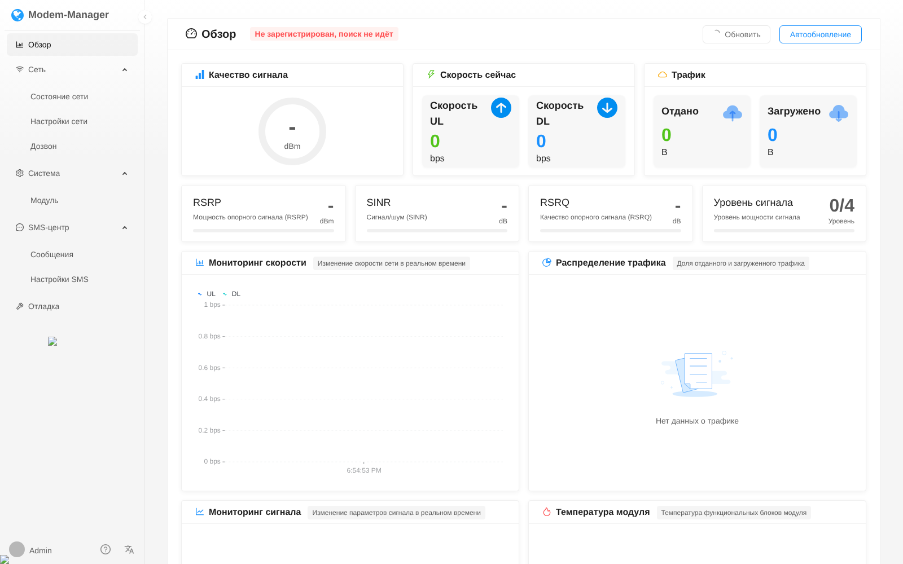

# Hiveton H5000M — русский перевод стоковой прошивки

Пакеты для роутера **Hiveton H5000M** со стоковой прошивкой
`ImmortalWrt 24.10-SNAPSHOT Build By Snowflakes` (сборка 20251231): переводят на русский всё,
что в ней осталось на китайском. Прошивку пересобирать не нужно.

| Пакет | Что переводит |
|---|---|
| `luci-i18n-modemwebui-ru` | Панель модема на порту `:8001` (Modem WebUI, «Powered by @Snowflakes»): меню, обзор, сеть, дозвон, APN/PDP, SIM/PIN, привязка к диапазонам и сотам, SMS, AT-терминал, температура модуля, встроенные тексты Ant Design |
| `luci-i18n-quickstart-ru` | Главная страница LuCI — QuickStart (iStoreOS): карточки, мастера, тест скорости, Wi-Fi, NAS/RAID |
| `luci-i18n-qmodem-next-ru` | Раздел **Modem** в меню LuCI (QModem Next 3.0.0) |



## Установка

Скачайте `.ipk` из [Releases](../../releases/latest) и установите:

```sh
scp -O luci-i18n-*-ru_*.ipk root@192.168.88.1:/tmp/
ssh root@192.168.88.1 'opkg install /tmp/luci-i18n-*-ru_*.ipk && rm /tmp/luci-i18n-*-ru_*.ipk'
```

Или прямо на роутере (нужен доступ к GitHub):

```sh
cd /tmp
for p in modemwebui-ru_1.2.2 quickstart-ru_1.01.2 qmodem-next-ru_3.0.0; do
  wget -q "https://github.com/dontbass/hiveton-h5000m-ru/releases/latest/download/luci-i18n-${p}-1_all.ipk"
done
opkg install /tmp/luci-i18n-*-ru_*.ipk && rm /tmp/luci-i18n-*-ru_*.ipk
```

После установки обновите страницы с **Ctrl+F5** (браузер кэширует JS).
Язык LuCI должен быть русским: *Система → Система → Язык и стиль*.

Удаление (оригинальные файлы восстанавливаются автоматически):

```sh
opkg remove luci-i18n-modemwebui-ru luci-i18n-quickstart-ru luci-i18n-qmodem-next-ru
```

## Как это работает

- **QModem** использует стандартный механизм LuCI: в нём английские msgid, поэтому хватает
  обычного `luci-app-qmodem-next.ru.lmo`.
- **QuickStart** грузит словарь `/luci-static/quickstart/i18n/<язык>.json` (vue3-gettext);
  пакет добавляет `ru.json`. Несколько строк, вшитых прямо в код, правятся байтовым патчем.
- **Modem WebUI** — это собранный UmiJS/React-бандл, в котором китайский вшит прямо в код
  (переключатель языка там — нерабочая заглушка шаблона). Пакет патчит бандлы на месте.

В репозитории **нет** чужого кода: только словари и байтовые патчи
(`смещение, длина, новая строка, исходная строка`). При установке
`files/ru-patch.uc` (ucode, есть в любой 24.10) сверяет md5 каждого файла с ожидаемым
оригиналом и только тогда применяет патч. При удалении пакета выполняется обратный
патч до байта, резервные копии не нужны.

Проверить состояние:

```sh
ucode /usr/share/hiveton-i18n/luci-i18n-modemwebui-ru/ru-patch.uc status /usr/share/hiveton-i18n/luci-i18n-modemwebui-ru/patches
```

`ru` — переведено, `original` — оригинал (например, после обновления пакета),
`unknown` — другая версия файла, патч к ней не подходит.

## Ограничения

- Патчи привязаны к конкретным версиям файлов (см. md5 в `patches/`). Если обновится
  `luci-app-modemwebui` или `luci-app-quickstart`, перевод этих частей слетит, а файлы
  с неизвестной контрольной суммой просто не тронутся. Пересоберите патчи (ниже)
  и пришлите PR.
- Переведён только интерфейс для модулей Quectel/FM350 (`/www/webui/webui000`).
  Отдельная копия интерфейса для MT5700M (`webui5700`) пока не переведена.
- Не переведены: текст под нерабочим переключателем языка, демо-страницы шаблона,
  которые не открываются из меню, и ответы самого модема.

## Для разработчиков

```
translations/
  qmodem-next/ru.po            перевод QModem (msgid на английском)
  quickstart/ru.json           словарь vue3-gettext для QuickStart
  quickstart/hardcoded.json    строки, вшитые в index.js
  quickstart/raw.json          мелкие правки шаблонных строк (пробелы)
  modemwebui/dict.json         китайский → русский для Modem WebUI (null = не трогать)
patches/                       сгенерированные байтовые патчи
files/ru-patch.uc              применение/откат патчей на роутере
tools/
  i18n.js                      extract / mkpatch на базе acorn
  mkpatches.sh                 пересборка patches/ из оригинальных файлов
  build.py, mkipk.py           сборка .ipk без SDK
```

Обновить перевод под новую версию:

1. Снимите оригиналы с роутера (до установки пакета или после `opkg remove`):
   `tar czf /tmp/src.tar.gz /www/webui/webui000/web /www/luci-static/quickstart`.
2. Распакуйте архив в каталог `dump/` и выполните `tools/mkpatches.sh dump`.
3. Найдите непереведённые строки в `/tmp/strings.json`, допишите их в
   `translations/modemwebui/dict.json` и повторите шаг 2.
4. Соберите пакеты: `python3 tools/build.py --po2lmo /path/to/po2lmo`.
   CI собирает их на каждый push, а релиз выпускает по тегу `v*`.

## Лицензия

MIT. `translations/qmodem-next/ru.po` распространяется под MPL-2.0 (лицензия QModem).

---

*English:* Russian translation packages for the Hiveton H5000M stock firmware (Modem WebUI on
:8001, iStoreOS QuickStart, QModem Next). Web bundles are patched on the device by md5-verified,
fully reversible byte patches. No third-party code is redistributed.
